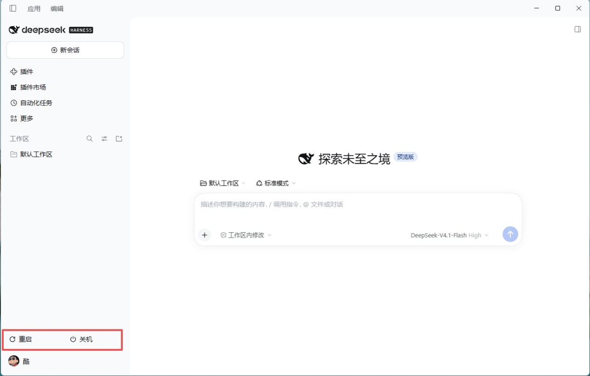
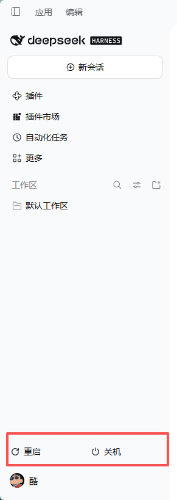

# dsh-restart-button

Two power actions for the **DeepSeek Harness Windows Desktop app**: **Restart**
and **Quit**, both above Settings in the sidebar foot.

> This is the **`Ylnana110/dsh-restart-button`** repository. Other repositories
> with the same name are unrelated; install from the full URL below.

| Installed in the sidebar | Close-up of the two buttons |
| --- | --- |
|  |  |

## Quick install

1. In DeepSeek Harness open **Plugins** → **Add plugin** → **Install a third-party plugin**.
2. Paste this address and press **Install**:

   ```
   https://github.com/Ylnana110/dsh-restart-button.git
   ```

   No Git installed? Download the
   [latest dsh-restart-button.tgz](https://github.com/Ylnana110/dsh-restart-button/releases/latest/download/dsh-restart-button.tgz)
   and paste its absolute path in the same dialog instead.

[中文说明](#中文说明)

## What it adds

- **Restart** — first press arms the button, a later press restarts the Desktop
  app and its Host process. This is what makes a freshly installed or removed
  plugin take effect.
- **Quit** — a single press closes the application completely, including its
  Host, sidecars, MCP servers and terminal processes.

Both actions appear only when the Host runs inside the Windows Desktop
application; in `dsh web` and on other platforms they stay hidden. The sidebar
foot is hidden while the sidebar is collapsed, so expand the sidebar to reach
them.

## Requirements

- DeepSeek Harness Desktop on **Windows** (tested on `0.2.2-rc.5`) or **macOS**.
- The bundle declares `dsh.bundle.platforms: ["win32", "darwin"]`, so other
  platforms show it as unsupported instead of installing a dead button.

> **macOS status:** the macOS path is implemented but has not been run on a Mac
> yet. It stops the app with `SIGTERM`/`SIGKILL` on the process tree and starts
> it again with `open -n "<App>.app"`. If it misbehaves, please open an issue with
> the log path printed in the failure message.

## Install

### From this repository (needs Git)

1. Open **Plugins** in the sidebar.
2. **Add plugin** → **Install a third-party plugin**.
3. Enter the Git address of this repository, for example
   `https://github.com/Ylnana110/dsh-restart-button.git`, then **Install**.

### From a release tarball (no Git needed)

1. Download `dsh-restart-button-<version>.tgz` from the **Releases** page.
2. Save it anywhere, then enter its absolute path in the same dialog.

### From a local checkout

Point the same dialog at the absolute path of this directory.

## How it works

The Host half serves three local routes on the Host's own HTTP carrier:
`GET /dsh-restart/status`, `POST /dsh-restart/restart` and
`POST /dsh-restart/quit`. A power request must come from the application page
(same-origin or the Desktop protocol) and carry the plugin's request header, so
cross-site POSTs are rejected.

Each request starts a small helper outside the application's process tree and
waits for it to report ready before answering the page.

- **Windows:** a short-lived PowerShell launcher creates a worker through WMI
  with `Win32_ProcessStartup.ShowWindow = 0`, so the worker survives the
  shutdown it performs and never shows a console window.
- **macOS:** the worker is a `/bin/sh` script started in its own session, so it
  survives the process tree it stops. The tree walk skips the worker itself,
  which is still a child of the Host until that process dies.

The worker stops the application and Host process trees and then either starts
the application again (restart) or exits (quit). Logs land in
`<temp>/dsh-restart-<pid>-<stamp>/restart.log` (`%TEMP%` on Windows).

The plugin registers no network clients and sends no data anywhere; it only
talks to the loopback Host it runs in.

## Safety notes

- Restart and quit interrupt running tasks, and scheduled tasks do not run while
  the app is closed.
- Quit is a hard process-tree stop, like ending the app from Task Manager: the
  graceful quit dialog is bypassed.
- Restart reuses the command line the application was started with and waits for
  the Host's listening port to be released before starting it again.

## Development

```powershell
# package exactly the files listed in package.json "files"
pnpm pack
```

Reinstall the bundle in the Plugins page after changing Host code.

## License

[MIT](LICENSE)

---

## 中文说明

给 **DeepSeek Harness Windows / macOS 桌面版**增加两个按钮，位于侧边栏底部、设置上方（Windows 已验证；macOS 路径已实现但未在真机实测）：

> 认准仓库 **`Ylnana110/dsh-restart-button`**；GitHub 上同名的其他仓库与本插件无关。

### 快速安装

1. 侧边栏 **插件** → **添加插件** → **安装第三方插件**。
2. 粘贴下面这个地址，点 **安装**：

   ```
   https://github.com/Ylnana110/dsh-restart-button.git
   ```

   没装 Git？下载
   [最新安装包 dsh-restart-button.tgz](https://github.com/Ylnana110/dsh-restart-button/releases/latest/download/dsh-restart-button.tgz)，
   在同一个对话框里填它的绝对路径即可。

- **重启**：第一次点击进入确认状态，再点一次才重启桌面应用及其 Host——插件安装/卸载后靠它生效。
- **关机**：按一下就直接关闭，连同 Host、后台 sidecar、MCP 服务与终端进程一起结束。

两个按钮仅在 Host 运行于 Windows 或 macOS 桌面应用时显示；`dsh web` 和其他平台不显示。侧边栏折叠时底部区域是隐藏的，需要先展开侧边栏。

安装后侧边栏底部、设置上方会出现「重启」「关机」两个按钮（见上方截图）。

### 安装

- **从仓库安装**（需要 Git）：侧边栏 **插件** → **添加插件** → **安装第三方插件** → 填
  `https://github.com/Ylnana110/dsh-restart-button.git` → 安装。
- **从 Release 安装包安装**（不需要 Git）：下载 Releases 里的
  `dsh-restart-button-<版本>.tgz`，在同一个对话框里填它的绝对路径。

### 注意

- 重启与关机都会中断正在运行的任务；应用关闭期间定时任务不会执行。
- 关机会强制结束整棵进程树（比菜单退出更彻底），不弹确认框。
- 插件只访问本机回环地址上的 Host，不联网、不上传数据。
